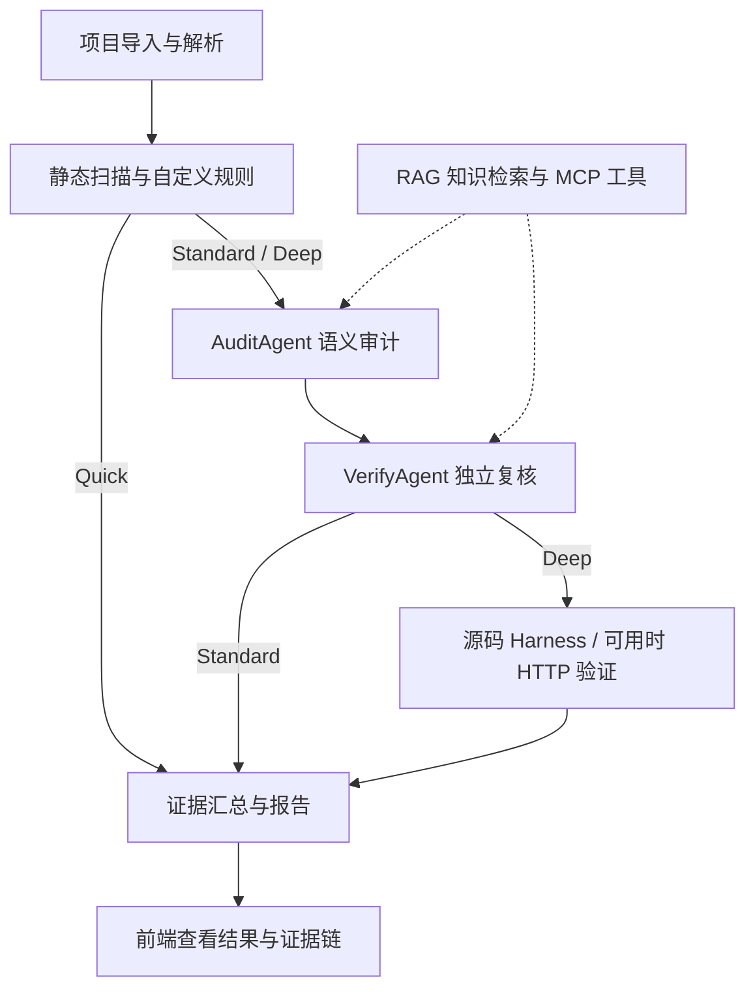

<p align="center">
  
</p>

<p align="center">
  <strong>代码安全审计 · 多智能体复核 · 分层验证 · 可追溯证据</strong>
</p>

<p align="center">
  <a href="https://github.com/ylj114514/AuditAgentX/actions/workflows/ci.yml"></a>
  <a href="README_EN.md">English</a> ·
  <a href="#项目介绍">项目介绍</a> ·
  <a href="#工作流程">工作流程</a> ·
  <a href="#快速启动">快速启动</a> ·
  <a href="#文档导航">文档导航</a>
</p>

> **项目性质：小学期课程作业 / 教学与研究原型（MVP）。**
> 本项目是我们在小学期完成的课程作业，用于学习和实践代码安全审计、多智能体协作、工具编排与漏洞验证。适用场景是本地代码、受控靶场及明确授权的实验环境。

## 项目介绍

扫描器报告了一条告警之后，还需要回答：输入从哪里来？经过哪些处理？现有防护是否有效？我们只是读了代码，还是确实执行过验证？

**AuditAgentX 围绕这些问题，把“发现候选 → 审计复核 → 条件允许时验证 → 汇总证据与报告”连接起来。** 它提供 FastAPI 后端和 Vue 3 前端，将传统静态扫描、自定义污点分析、LLM Agent、RAG 知识检索、MCP 工具调用和隔离验证放在同一条流程中。

项目的重点是让每个结论能对应到源码、工具状态和实际取得的证据。当前实现仍有课程原型的局限：目标项目能否启动、语言与框架覆盖程度、模型输出质量、外部工具和沙箱是否可用，都会影响结果。

<table>
  <tr>
    <td width="33%" valign="top"><strong>01 · 发现候选</strong><br/><br/>聚合扫描工具和自定义规则的结果，保留来源、位置与逐工具执行状态。</td>
    <td width="33%" valign="top"><strong>02 · 独立复核</strong><br/><br/>检查输入、传播路径、危险操作和现有防护，区分误报与仍需人工确认的情况。</td>
    <td width="33%" valign="top"><strong>03 · 说明证据</strong><br/><br/>分别记录静态判断、函数级触发和入口级验证，汇总为可查看的证据链与报告。</td>
  </tr>
</table>

## 功能一览

| 模块 | 当前实现 | 相关入口 |
| --- | --- | --- |
| 项目导入与解析 | 读取本地目录或拉取 Git 仓库，解析文件、语言和依赖等上下文 | [`backend/repository/`](backend/repository/) |
| 静态扫描 | 编排 Semgrep、Bandit、Gitleaks、Trivy 和自定义规则；记录工具未安装、失败和部分结果 | [`backend/scanners/`](backend/scanners/) |
| 智能体审计与复核 | AuditAgent 补充语义分析，VerifyAgent 复核告警和防护条件 | [`backend/agents/`](backend/agents/) |
| 协作与知识检索 | ACP 结构化消息与 trace、MCP 工具调用、CWE / OWASP / 验证 playbook 检索 | [`backend/acp/`](backend/acp/) · [`backend/mcp/`](backend/mcp/) · [`backend/rag/`](backend/rag/) |
| 动态验证 | 函数级源码 Harness，以及目标具备运行条件时的 Docker / HTTP 验证 | [`backend/verifier/`](backend/verifier/) |
| 证据与报告 | 汇总源码位置、数据流、验证结果、日志和报告产物 | [`backend/report/`](backend/report/) |
| 可视化界面 | 项目创建、扫描工作台、漏洞详情、证据链、历史记录、报告和统计 | [`frontend/src/pages/`](frontend/src/pages/) |

外部扫描器需要另外安装并启用；缺少某个工具不等于它已经完成扫描且“零发现”。自定义规则会作为扫描流程的兜底项运行。

## 工作流程

下图展示不同模式如何进入同一条证据与报告流程。动态验证需要目标和执行环境满足相应条件。



| 模式 | 主要流程 | 使用前需要考虑 |
| --- | --- | --- |
| **Quick** | 静态扫描 | 检查所选扫描器是否安装；不进入 LLM 审计、独立复核或动态验证 |
| **Standard** | 静态扫描 + LLM 审计 + 独立复核 | 配置可用的模型接口；不主动执行动态请求 |
| **Deep** | 在复核基础上尝试 Harness 与项目级动态验证 | 准备 Docker、必要的运行时和授权目标；启动失败或缺少依赖时应保留失败状态 |

模式配置入口：[`backend/api/routes_scans.py`](backend/api/routes_scans.py)。

### 验证结果应该怎样读

| 证据或状态 | 可以说明什么 | 仍然不能据此推出什么 |
| --- | --- | --- |
| 静态告警 / 静态复核 | 工具或审阅发现了可疑路径、防护条件，或具体误报依据 | 已执行目标、已确认运行时可利用 |
| `mechanism_confirmed` | 内置模板演示了某类漏洞的机理 | 原项目的真实函数或真实入口存在漏洞 |
| `function_reproduced` | 真实源码函数在隔离条件下触发了对应行为 | 外部输入一定能从真实应用入口到达它 |
| Harness 的 `target_confirmed` | 通过额外约束确认了目标调用与入口可达性证据 | 自动等同于完整的 HTTP 请求复现 |
| HTTP 的 `dynamic_confirmed` | 相应验证满足了 HTTP 路径的确认条件 | 整个项目安全，或所有同类路径都已验证 |
| `not_executed` / `sandbox_failed` / `not_reproduced` | 分别表示未执行、执行环境失败、已尝试但未复现 | 这些状态可以互换，或能够一概判定“没有漏洞” |

函数级验证会使用 mock 或桩替代危险操作，并核对框架取得的调用证据。脚本自行输出“成功”不能单独作为目标已复现的证明。具体裁决见 [`harness_verifier.py`](backend/verifier/harness_verifier.py) 与 [`pipeline.py`](backend/verifier/pipeline.py)。

## 快速启动

建议使用 **Python 3.11、Node.js 20 和 Git**，与仓库 CI 配置保持一致。动态验证另需 Docker；扫描工具、模型接口与 PDF 导出组件按功能单独准备。

### 1. 获取项目与安装后端依赖

以下以 Windows PowerShell 为例；已有 `.env` 时请保留自己的配置。

```powershell
git clone https://github.com/ylj114514/AuditAgentX.git
cd AuditAgentX
python -m venv .venv
.\.venv\Scripts\python.exe -m pip install -r requirements.txt
Copy-Item .env.example .env
```

编辑 `.env`，为需要模型的流程填写 `LLM_API_KEY`、`LLM_BASE_URL` 和 `LLM_MODEL`。示例值是占位配置，不能直接用于调用；真实密钥请保留在本地。

### 2. 启动后端

```powershell
.\.venv\Scripts\python.exe -m uvicorn backend.main:app --reload --host 127.0.0.1 --port 8000
```

### 3. 在另一个终端启动前端

```powershell
cd frontend
npm ci
npm run dev
```

| 入口 | 默认地址 |
| --- | --- |
| Web 界面 | <http://localhost:5173> |
| FastAPI 接口文档 | <http://127.0.0.1:8000/docs> |
| 后端健康检查 | <http://127.0.0.1:8000/health> |

如果修改后端端口，本地前端需要同步设置 `VITE_API_PROXY_TARGET`。界面能够打开，并不代表模型、所有扫描器和动态验证环境都已就绪。

<details>
<summary><strong>容器化演示、模拟靶场与 Harness 镜像</strong></summary>

先按 `.env.example` 准备 `.env`，再从仓库根目录启动平台的本地容器化演示：

```powershell
docker compose up --build backend frontend
```

Compose 默认将后端和前端映射到宿主回环地址，持久化数据写入 `data/`。前端容器运行 Vite 开发服务器；此配置用于本地演示。

可单独启动安全 SQLi 模拟靶场：

```powershell
docker compose up --build safe-sqli-target
```

默认地址为 <http://127.0.0.1:8080>。该靶场模拟响应，**不执行真实 SQL**，其结果不能当作真实数据库漏洞的证明。

可选的固定 Harness 镜像：

```powershell
docker build -t auditagentx-harness-python:latest docker/harness
```

随后按实际需要配置 `HARNESS_SANDBOX_IMAGE`。整项目容器启动、固定镜像和函数切片是不同路径，各自仍受依赖、运行时和支持范围限制。

更多部署与故障排查说明见 [`DOCKER_DYNAMIC_TESTING_GUIDE.md`](docs/DOCKER_DYNAMIC_TESTING_GUIDE.md)。

</details>

## 文档导航

| 我想了解…… | 从这里开始 |
| --- | --- |
| 整个项目如何组织、各目录做什么 | [项目总览](docs/PROJECT_OVERVIEW.md) |
| Docker、Deep 模式、网络关系和失败排查 | [动态验证与 Docker 指南](docs/DOCKER_DYNAMIC_TESTING_GUIDE.md) |
| 多语言动态验证的支持范围 | [语言支持说明](docs/DYNAMIC_LANGUAGE_SUPPORT.md) |
| Agent 如何分工 | [Agents 说明](backend/agents/README.md) |
| Skill 如何调用项目内 MCP 工具 | [Skills 与工具映射](backend/skills/README.md) |
| 扫描器、知识检索与通信实现 | [Scanners](backend/scanners/README.md) · [RAG](backend/rag/README.md) · [ACP](backend/acp/README.md) · [MCP](backend/mcp/README.md) |

仓库里的 `backend/skills/` 是平台内部的工作流定义，包含项目工具依赖。使用或单独分发时，应一并说明工具配置与适用范围。

## 目录概览

```text
AuditAgentX/
├── backend/       # API、Agent、扫描器、知识检索、验证与报告
├── frontend/      # Vue 3 + TypeScript + Element Plus
├── rules/         # Semgrep / custom 等规则
├── tests/         # 后端单元测试、集成测试与验证边界测试
├── scripts/       # 批量扫描、知识库生成与评测脚本
├── benchmarks/    # 评测相关数据
├── examples/      # 演示项目与安全模拟靶场
├── docker/        # Harness 沙箱镜像定义
├── data/          # 本地运行数据、报告、缓存与沙箱目录
└── docs/          # 技术说明与展示素材
```

## 测试与评测

| 任务 | 命令 |
| --- | --- |
| 后端测试（已进入后端虚拟环境） | `python -m pytest tests/ -q` |
| 前端类型检查与构建（在 `frontend/`） | `npm run build` |
| OWASP BenchmarkJava 分类评测 | `python scripts/run_owasp_benchmark.py` |

CI 配置见 [`.github/workflows/ci.yml`](.github/workflows/ci.yml)。BenchmarkJava 需要另外准备本地数据集；结果应附带数据集版本、工具与规则配置、类别范围和实际运行输出。早期实验数字不能代替当前版本的评测。

## 使用范围与课程项目说明

- 本项目面向课程学习、方案实验与明确授权的代码审计。当前仍是 MVP，不能据此承诺生产环境覆盖率或漏洞检出率。
- 动态验证默认限制到回环目标。真实第三方项目可能无法自动构建、启动或完成鉴权，失败需要保留为失败或待确认状态。
- Docker 容器内的 `127.0.0.1` 指向容器自身；宿主访问容器要使用正确的端口映射，容器互访要使用适当的服务地址。
- 默认业务容器不挂宿主 Docker socket；如自行启用执行器挂载，需要了解这会授予后端很高的宿主控制权限。
- `.env`、认证信息和真实密钥应保留在本地，避免进入仓库、报告或镜像。

欢迎围绕课程实现、误报分析、验证证据和可复现实验提出 [Issue](https://github.com/ylj114514/AuditAgentX/issues)。后续改进与维护视实际时间安排进行。
