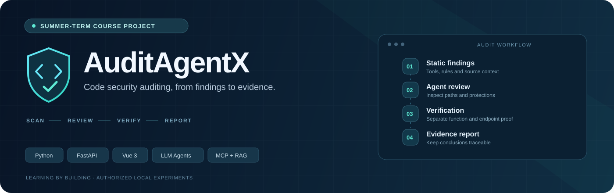
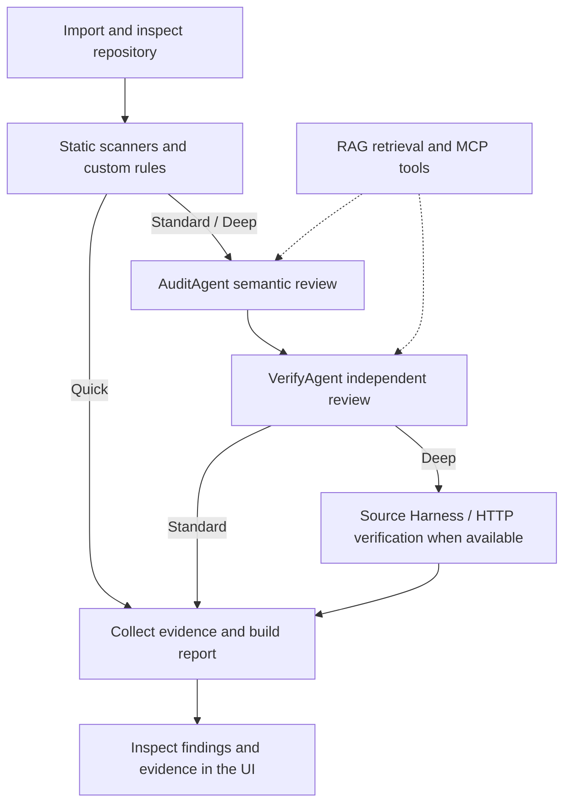

<p align="center">
  
</p>

<p align="center"><strong>Static findings · Agent review · Verification · Traceable evidence</strong></p>

<p align="center">
  <a href="https://github.com/ylj114514/AuditAgentX/actions/workflows/ci.yml"></a>
  <a href="README.md">简体中文</a> ·
  <a href="#about-the-project">About</a> ·
  <a href="#workflow">Workflow</a> ·
  <a href="#getting-started">Getting started</a> ·
  <a href="#documentation">Documentation</a>
</p>

> **A summer-term course assignment and an educational research prototype (MVP).**
> We built AuditAgentX as coursework to explore code security auditing, agent collaboration, tool orchestration and vulnerability verification. It is intended for local source code, controlled test environments and explicitly authorized experiments.

## About the project

A scanner alert is the beginning of a review. Where does the input come from? Which protections apply to that exact path? Has anyone actually executed the relevant code, or is the conclusion based on source inspection alone?

**AuditAgentX connects candidate discovery, agent review, verification when feasible, and evidence reporting.** A FastAPI backend and Vue 3 frontend bring together static scanners, custom taint analysis, LLM agents, RAG knowledge retrieval, MCP tools and isolated verification.

The project focuses on keeping conclusions tied to source locations, tool status and observed evidence. Coverage depends on the language, framework, target setup, model quality and available tooling. This is a course prototype, with the limitations that implies.

<table>
  <tr>
    <td width="33%" valign="top"><strong>01 · Find candidates</strong><br/><br/>Combine scanner and custom-rule findings while retaining their source and execution status.</td>
    <td width="33%" valign="top"><strong>02 · Review independently</strong><br/><br/>Inspect controllable inputs, data flow, dangerous operations and the protections on the actual path.</td>
    <td width="33%" valign="top"><strong>03 · Explain the evidence</strong><br/><br/>Separate static judgments, function-level behavior and entrypoint verification in the final report.</td>
  </tr>
</table>

## Capabilities

| Area | Implementation |
| --- | --- |
| Repository input | Local directories or Git repositories, with file, language and dependency context |
| Static scanning | Semgrep, Bandit, Gitleaks, Trivy and custom rules, with per-tool availability and execution status |
| Agent review | AuditAgent semantic analysis and VerifyAgent review of findings and protections |
| Coordination and knowledge | ACP messages and traces, MCP tool calls, and CWE / OWASP / verification-playbook retrieval |
| Verification | Source-based function Harnesses and Docker / HTTP verification when target requirements are met |
| Evidence and reporting | Source locations, data flow, verification observations, logs and report artifacts |
| Interface | Project creation, scan workspace, finding details, evidence, history, reports and analytics |

External scanner CLIs must be installed and enabled separately. An unavailable or failed scanner must not be interpreted as a successful scan with no findings. Custom rules are retained as a fallback in the scan pipeline.

## Workflow



| Mode | Scope | Requirements |
| --- | --- | --- |
| **Quick** | Static scanning; no LLM audit, independent verification or dynamic verification | Selected scanners must be available |
| **Standard** | Static scanning, LLM audit and independent review; no proactive dynamic requests | A working model endpoint and credentials |
| **Deep** | Adds attempts at Harness and project-level dynamic verification | Docker, suitable runtimes, an authorized target and viable target setup |

Mode configuration lives in [`backend/api/routes_scans.py`](backend/api/routes_scans.py).

### Interpreting verification results

| Evidence or status | What it supports | What it does not establish |
| --- | --- | --- |
| Static finding or review | A suspected path, a protection, or a candidate-specific false-positive explanation | Runtime exploitability |
| `mechanism_confirmed` | A template demonstrated a vulnerability mechanism | A vulnerability in the actual project |
| `function_reproduced` | Real source code triggered the relevant behavior under isolated test conditions | Reachability from a real application entrypoint |
| Harness `target_confirmed` | Additional constraints for target invocation and entrypoint evidence were satisfied | Automatic equivalence to a complete HTTP reproduction |
| HTTP `dynamic_confirmed` | The HTTP verification path met its confirmation conditions | Safety or coverage of the entire application |
| `not_executed`, `sandbox_failed`, `not_reproduced` | No execution, an environment failure, or an unsuccessful reproduction attempt, respectively | That these states are interchangeable, or that the vulnerability is absent |

Function tests use mocks or stubs for dangerous operations and evaluate evidence obtained by the framework. A generated script's own success claim is insufficient. See [`harness_verifier.py`](backend/verifier/harness_verifier.py) and [`pipeline.py`](backend/verifier/pipeline.py).

## Getting started

Use **Python 3.11, Node.js 20 and Git** to match the CI configuration. Docker is additionally needed for the corresponding verification paths. Scanner CLIs, a model endpoint and optional PDF export components are separate requirements.

The commands below use a POSIX shell. Windows PowerShell instructions are in the [Chinese README](README.md#快速启动).

```bash
git clone https://github.com/ylj114514/AuditAgentX.git
cd AuditAgentX
python3 -m venv .venv
.venv/bin/python -m pip install -r requirements.txt
cp .env.example .env
```

For a new checkout, edit `.env` and supply `LLM_API_KEY`, `LLM_BASE_URL` and `LLM_MODEL` for flows that use a model. Keep an existing `.env` rather than overwriting it; keep real credentials local.

Start the backend:

```bash
.venv/bin/python -m uvicorn backend.main:app --reload --host 127.0.0.1 --port 8000
```

In another terminal, from the repository root:

```bash
cd frontend
npm ci
npm run dev
```

| Entry | Default URL |
| --- | --- |
| Web interface | <http://localhost:5173> |
| API documentation | <http://127.0.0.1:8000/docs> |
| Health endpoint | <http://127.0.0.1:8000/health> |

Set `VITE_API_PROXY_TARGET` when changing the backend port for local frontend development. A reachable interface does not establish that models, scanners or sandbox verification are ready.

<details>
<summary><strong>Local Docker demonstration and sample target</strong></summary>

Prepare `.env` first, then run from the repository root:

```bash
docker compose up --build backend frontend
```

This is a local demonstration configuration; the frontend container runs Vite's development server. Services bind to host loopback addresses by default and persist runtime data under `data/`.

To start the safe SQLi simulation target separately:

```bash
docker compose up --build safe-sqli-target
```

Its default URL is <http://127.0.0.1:8080>. It simulates responses and **does not execute real SQL**. Results from this fixture are not proof of a real database vulnerability.

See the [Docker and verification guide](docs/DOCKER_DYNAMIC_TESTING_GUIDE.md) for Harness images, target startup and network troubleshooting.

</details>

## Documentation

The detailed implementation guides are currently in Chinese.

| Topic | Guide |
| --- | --- |
| Project structure and modules | [Project overview](docs/PROJECT_OVERVIEW.md) |
| Docker, Deep mode and troubleshooting | [Dynamic verification guide](docs/DOCKER_DYNAMIC_TESTING_GUIDE.md) |
| Language and runtime coverage | [Language support](docs/DYNAMIC_LANGUAGE_SUPPORT.md) |
| Agent responsibilities | [Agents](backend/agents/README.md) |
| Skills and project tool dependencies | [Skills and tools](backend/skills/README.md) |
| Scanners, retrieval and protocols | [Scanners](backend/scanners/README.md) · [RAG](backend/rag/README.md) · [ACP](backend/acp/README.md) · [MCP](backend/mcp/README.md) |

`backend/skills/` contains internal platform workflow definitions with project tool dependencies. Reuse or separate distribution requires documenting those dependencies and the supported environment.

## Validation and scope

- Backend tests: `python -m pytest tests/ -q` in the configured Python environment.
- Frontend type checking and build: `npm run build` from `frontend/`.
- OWASP BenchmarkJava evaluation: `python scripts/run_owasp_benchmark.py`, with the dataset prepared locally.
- Report performance alongside the dataset version, tool configuration, category coverage and actual output. Historical experiments do not establish current performance.
- Use local or explicitly authorized targets. Target build failures, missing dependencies and incomplete authentication can prevent verification and must remain visible in the result.
- Container loopback addresses refer to the container itself. Use the appropriate port mapping or service address for host/container communication.
- The default business container does not mount the host Docker socket. Enabling an executor mount grants substantial host control and requires a controlled environment.
- Keep credentials out of source control, reports and images.

Questions about the coursework, false positives, evidence and reproducible experiments are welcome through [Issues](https://github.com/ylj114514/AuditAgentX/issues). Future improvements and maintenance depend on available time.
